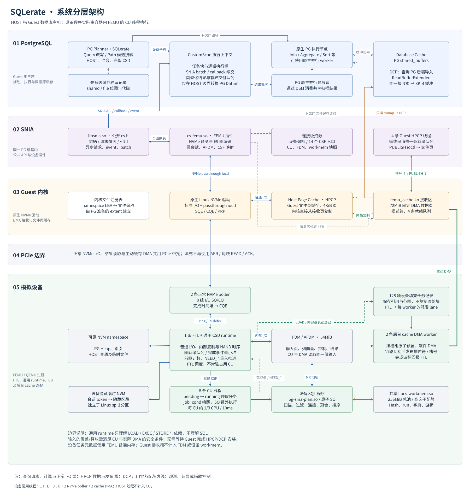
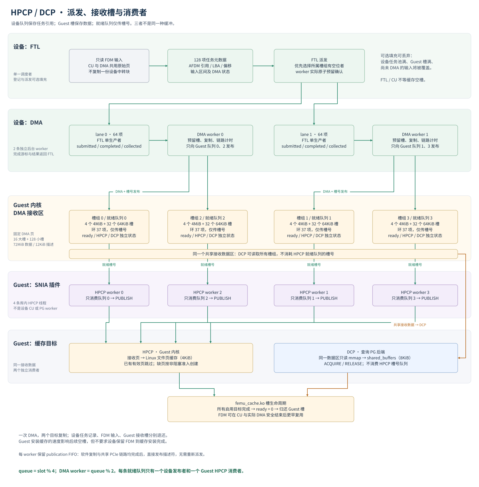

# SQLerate 系统架构

本文描述当前代码实现：PostgreSQL 扩展、SNIA 公共库及 FEMU 插件运行在 Guest，FEMU 模拟设备及设备程序运行在容器内的 QEMU/FEMU 进程。设备端采用通用任务图执行机制，SQL 语义由设备 SQL 程序实现。

文中的 **HOST** 是 Guest 中运行 PostgreSQL 的数据库主机；**仿真宿主机**是运行 Docker/QEMU 的物理机器。HPCP 的 Host Page Cache 指 Guest Linux 文件页缓存，不是容器或物理宿主机的文件缓存。设备地址转换层称为 **FTL（Flash Translation Layer）**。

## 1. 全局架构

可编辑源文件：[sqlerate-architecture.drawio](figures/sqlerate-architecture.drawio)，包含“系统分层总览”和“HPCP-DCP 队列与槽位”两页，可直接用 draw.io / diagrams.net 打开。节点、文字和连线均为原生可编辑对象；每页还分为背景、连线、组件、说明四个可切换图层。

后续修改以 `.drawio` 为源文件，按页导出 SVG 覆盖本目录 `figures/architecture-overview.svg` 和 `figures/architecture-population.svg`，保持文档预览同步。

下图为同版 SVG 预览。蓝色表示查询/正常 I/O，绿色表示 HPCP，橙色表示 DCP 或工作状态，灰色虚线表示观测/辅助控制。横向泳道表示运行层级，同一进程内的模块划分不代表额外进程或线程。

正常查询结果沿 `AFDM → NVMe 读取 → SNIA → CustomScan → PG Datum` 返回。缓存填充则沿旁路 `AFDM → 主动 DMA → Guest 接收槽 → HPCP/DCP` 进行；这两条路径的数据、队列和完成条件不同。

## 2. 分层职责与接口

| 层级 | 运行位置 | 负责什么 | 与相邻层的接口 |
| --- | --- | --- | --- |
| PG 原生规划/执行 | Guest PG 后端及原生并行 worker | SQL 解析、统计、合法连接枚举、HOST 节点及最终查询结果 | PG Query/Path/Plan、CustomPath/CustomScan hook、Datum/TupleSlot |
| SQLerate 扩展 | Guest PG 后端 | 改写 Query、搜索 HOST/CSD 路径、编码设备计划、分配任务块和资源、转换返回值 | 向下直接链接 `libsnia.so`，包含 `cs.h`；缓存侧访问 `/dev/femu-cache` 和 PG 缓冲 API |
| SNIA 公共 API | 同一 Guest 应用进程 | 标准 API、资源句柄、请求快照、引用管理、异步执行、callback/event、batch 依赖 | 对外 C API；向下使用 `cs_backend_ops` C 函数表 |
| FEMU 设备适配器 | Guest 的 `cs-femu.so` | 设备发现、参数检查、AFDM/CSF 映射、NVMe 命令、E9 图编码、缓存接收生命周期 | Linux NVMe passthrough；FEMU 私有图/接收协议 |
| Guest 缓存接收模块 | Guest 内核 `femu_cache.ko` | 固定 DMA 页、文件 extent 注册、接收槽生命周期、HPCP 页发布、DCP 只读映射 | `/dev/femu-cache` ioctl/mmap；设备侧 `0xeb` 注册与停止 |
| NVMe 前端 | FEMU poller 线程 | 取 SQE、PRP/SGL 映射、命令分派、带时间戳的完成及 CQE | Guest 标准 NVMe 队列；设备内部 `to_ftl/to_poller` ring 和 defer 路径 |
| FTL / 通用设备运行时 | FEMU，图推进由 FTL 线程执行 | NVM 时序、内部读取/写入、图依赖、完成事件、就绪任务和可重入 I/O | `LOAD/EXEC/STORE` 图、原生 `femu_csd_args`、64 位完成值 |
| SQL 设备运行时/算子 | FEMU CU 线程 | 解释 SQL 设备计划、列向量计算、阻塞状态、局部/共享聚合、连接、排序与 spill | MR 所指 AFDM、workmem context、`CompValue` 中的普通状态或 NEED_* |
| 内存与临时存储 | FEMU 进程中的不同资源池 | FDM 输入输出、受限工作区、可见 NVM、隐藏 spill | AFDM ID/范围、共享分配器 context、隐藏区 token |

**两种 runtime 的区别：**通用设备运行时是编译进 FEMU 的 `csd.c`，不解释 SQL，也不需要加载一个调度 SO 来常驻占用 CU。`pg-sina-plan.so` 是应用专属的 SQL 执行器；其协调入口和普通工作入口每次都由同一 CU 池执行，返回后释放 CU。两者没有通过给 `femu_csd_args` 添加 runtime 指针来连接。

## 3. PG 如何生成并执行设备工作

### 3.1 准备、连接初始化和查询资源

只读数据准备时，`sina_csd.prepare` 检查 visible/frozen、schema、relfilenode、文件段和 FIEMAP extent，将 Heap/索引的逻辑偏移映射成 namespace LBA。结果保存在 `sina_csd.relations/columns/indexes/extents`。设备只接收已经转换的物理范围，不解析文件系统或表目录。

扩展在每个普通 PG 连接加载时发现并打开设备、查询 CU/FDM、下载激活全部 14 个 CSF 入口，并调用容量 CSF 获取 workmem。资源保留到连接退出；PG 原生并行 worker 只注册扩展方法，不重复初始化这套连接资源。每个后端的程序编号分段隔离，同一后端的多个子树复用已加载入口。

查询独立管理 AFDM、batch、执行槽和 workmem 状态。没有 namespace 级查询执行锁；不同任务通过独立资源和明确依赖隔离。设备元数据、分配器和算子共享状态内部仍有必要的锁，这不等于整条查询串行执行。

### 3.2 规划与五种模式

SQLerate 通过 PG 的扫描、连接及上层 Path hook，把设备候选加入原生路径搜索。PG 负责合法的连接配对和 HOST 算法；扩展为可编译子树确定设备物理属性，再估计设备 I/O、CU 阶段、状态容量/spill、返回边界及填充开销，最终选中的候选才编码完整设备执行记录。

原始 HOST、原始 PG 物理树的完整 CSD 版本，以及安全改写 Query 后的共享搜索候选均可参与比较。去关联作用于 Query 对象，不改 SQL 文本。当前搜索不是在最终 HOST 计划上逐节点贴标签，也不穷尽所有已被 PG 剪掉的组合。

允许 `CSD → CSD` 和 `CSD → HOST`，不支持 HOST 中间结果重新输入 CSD。共享内部状态的 build/probe、sink/source 留在同一侧；已有局部聚合再向 HOST 合并等可交付边界按实际能力处理。

| `exe_path` | 执行范围 | HPCP 策略 |
| --- | --- | --- |
| `host-only` | 原生 PG | 无设备填充 |
| `filter-only` | 支持的扫描/过滤卸载，其余 PG 执行 | 关闭 |
| `csd-without-hpcp` | 支持的完整子树尽可能卸载 | 关闭 |
| `csd-with-hpcp` | 同上 | 允许开启 |
| `SQLerate` | 按成本选 HOST、混合或完整 CSD | CSD 子树允许开启 |

`pg_sina_csd.hpcp` 是允许开关，`pg_sina_csd.dcp` 独立控制 DCP，默认分别为 on/off。DCP 不是“遇到索引才自动开启”；产生设备读取时是否启用由显式配置决定。现有五模式实验脚本在后两种模式同时打开 HPCP/DCP，前三种模式关闭两者。所有模式共享相同算子、并行交付及资源策略。

### 3.3 三种图/计划不能混为一谈

| 对象 | 谁生成 / 谁理解 | 表达的内容 |
| --- | --- | --- |
| PG Query/Path/Plan | PG 与扩展 | SQL 语义、统计、连接顺序、HOST/CSD 候选及返回边界 |
| `qp_plan` | 扩展生成，设备 SQL SO 理解 | Scan/Join/Aggregate/Sort 等节点、表达式、extent、缓冲偏移及流水线属性 |
| `femu_graph_header/node` | FEMU 插件生成，通用设备 runtime 理解 | LOAD/EXEC/STORE 及依赖位图；不包含 SQL 表、Join 或 Aggregate 类型 |

一个 SQL 设备计划可以通过多张有限的 E9 图逐块推进；一张图中的一个 EXEC 也可以连续执行多个 SQL 算子。因此不是每个 SQL 算子都对应一次 NVMe E1 或一次独立 SO 加载。

### 3.4 执行槽、任务块与 HOST 返回

扩展按查询资源选择逻辑执行槽，默认优先采用设备 CU 数，再受 FDM、workmem 和数据量约束；当前实现上限 64 槽。执行槽保存输入缓冲、控制和在途请求，不与某条物理 CU 线程永久绑定。

顺序扫描通常按 4MiB 块派发，内存约束下可缩小。空闲执行槽领取下一个不重叠块，通过 SNIA 提交 `LOAD → EXEC`；完成 callback 可继续领取和提交，避免等待同一轮最慢分支。callback 只处理稳定的 C 数据和 SNIA，不调用 PG API。阶段协调、某些返回边界或资源屏障仍可能需要 PG 主线程/协调入口推进，不能把所有流水线都描述为完全自主的无限任务流。

设备从 Heap 中提取所需列，使用列向量、NULL/精度信息和 selection，尽可能延迟解码/物化过滤后才需要的列。SQL 程序内部保留向量或紧凑行批次；只有边界返回给 HOST 时才生成 PG 可消费的数据。

通用计划入口接收五个 AFDM：计划和映射、控制记录、结果/内部交接、输入页/列批次/字典配置、spill I/O。它们的布局属于 PG 与 SQL SO 的约定。完整 CSD 返回通常很小；扫描下推则返回类型化投影批次，不把大结果强制转换为同一个固定宽度布局。

共享扫描使用两个有界 HOST 结果批次作为交付队列，可放在 DSM 中供原生 PG 并行参与者消费。设备资源由原执行上下文和 SNIA callback 管理，PG worker 只消费已交付数据；没有额外选举一个 PG worker 来承担设备提交。HOST 消费过慢时结果队列会反压，这是查询结果交付，与可丢弃的缓存填充不同。

## 4. SNIA 与 NVMe 边界

应用只需 `#include "cs.h"` 并链接 `-lsnia`。公共实现为 C++，公开入口保持 C；动态设备插件通过 `cs_backend_create` 返回版本化 C 函数表。句柄绑定插件及其私有资源，公共层无需识别 NVMe 字段。

公共请求层保存请求快照和资源引用，进程内异步线程执行已绑定的后端操作，再投递 callback/event。同步 API 可直接执行。batch 的 SERIAL/PARALLEL/HYBRID 依赖语义由公共层检查；设备插件支持整批执行时，优先交给插件。

FEMU 插件将纯 LOAD/STORE/compute batch 编码为一条 **E9 EXEC_GRAPH**。含 HOST↔AFDM 复制的 batch 在执行前选择公共软件调度，其中 compute 仍可用单节点设备图完成重入。不是所有 batch 都可以不经区分地编码为一张图。

| 请求 | FEMU 接口 | 作用 |
| --- | --- | --- |
| 发现及资源查询 | NVMe Identify；admin `0xc0 GET_INFO` | namespace、FDM 容量/使用量、CU 等 |
| `csAllocMem/csFreeMem` | I/O `0xb0/0xc0` | 分配/释放 AFDM，按引用保留在途资源 |
| `csQueueStorageRequest` | I/O `0xd0/0xd1` | 可见 namespace 的 NVM→AFDM / AFDM→NVM，数据不绕 HOST |
| HOST↔AFDM 复制 | I/O `0xf5/0xf2` | 上传计划/控制/数据，或取回结果 |
| 原生单次 compute | I/O `0xe1` | 已加载 CSF 的一次执行 |
| 设备 batch | I/O `0xe9` | LOAD/EXEC/STORE 图及依赖；图内操作不各发一条 Guest NVMe 请求 |
| 图会话与取消 | I/O `0xea` | OPEN/CLOSE/CANCEL、失败回收归属 |
| CSF 下载/激活 | admin `0x22/0x25/0x23` | 选择入口、装载数据及激活 |
| 缓存接收区 | I/O `0xeb`，由 Guest 模块提交 | 注册固定 DMA 页及描述符地址，停止发送 |

admin 和 I/O 的 `0xc0` 位于不同命令空间。E9/EA/EB、NEED_*、缓存配置均为本项目的 FEMU 约定，不是 SNIA 新增的标准函数或标准状态。

图至多 64 节点、1MiB 描述，当前设备至多 64 张在途图。每个节点有操作、前驱位图、AFDM/范围或 CSF/MR/标量参数；所有前驱完成后才能就绪。图会话用于资源归属，不是一个进程或 CU。

SERIAL 模式依次启动节点，PARALLEL 模式没有依赖边，HYBRID 模式同时启动所有已满足前驱的节点。共享 AFDM 的读写顺序由提交者明确给出依赖；设备不从地址或 SQL 语义猜测数据冲突。

MR 在设备中解析成 AFDM 地址，形成原生 `femu_csd_args` 的 `mr_addr/mr_len`；两个独立 64 位标量分别对应 `cparam1/cparam2`。原生结构还保留 `data_buffer/buffer_len`，当前 SNIA compute 适配没有使用这条附加字节路径。CSF 的普通 64 位返回值经 CQE 和 SNIA `CompValue` 返回；参数顺序由调用双方约定，不增加通用参数解码器。

## 5. 设备内部调度与存储

### 5.1 NVMe poller、FTL 和 CU

当前 8 组 I/O SQ/CQ 按每 poller 4 组分给 2 条 poller，不是一条 poller 对应一个请求或一个 CU。普通请求通过 `to_ftl[poller]` 交给控制器唯一 FTL，完成经 `to_poller[poller]` 回到所属 poller。poller 的完成优先队列按 `expire_time` 决定何时写 CQE，未到期请求留在队列中，不为每个请求创建等待线程。

E9 接收/校验后走设备图 defer 路径；FTL 主循环同时推进设备图和普通存储请求。内部 LOAD/STORE 复用 NVM/FTL 时序并进行 RAM 后端与 AFDM 的软件复制，不能把它理解为完全没有 CPU 成本的时间戳更新。

| 设备结构 | 位置/所有者 | 作用 |
| --- | --- | --- |
| `graphs`、session 表 | `FemuCsdState` | 在途图、会话、取消及资源归属 |
| `graph_ready` | FTL 消费 | 需要继续推进的图；节点就绪由位图表示 |
| `graph_events` + 最早 deadline | CU/FTL 插入，FTL 消费 | I/O/计算完成时间最小堆；空闲路径只查最早到期时间 |
| 节点 `remaining/dependents` | 通用设备 runtime | 剩余前驱计数与后继位图，不反复扫描整张依赖图 |
| CU `pending/running` | 通用设备 runtime | 已就绪 CSF 调用和正在运行的调用；条件变量唤醒空闲 CU |
| `afdms/programs/mrs` | 通用设备 runtime | AFDM、已加载程序及范围的引用管理 |

CU 从 pending 取一次调用，在不持设备调度锁时执行 native SO；返回后登记完成事件。I/O 等待不占用 CU，其他就绪任务可使用它。同一程序 ID 的调用不强制串行；共享 Hash、聚合或字典状态的同步由 SQL 程序负责。

完成最小堆由 FTL 按到期事件推进；完成一个节点，只递减其后继的计数并解锁新就绪节点。普通 NVMe 完成堆与 CSD 图事件堆使用相同的基础优先队列实现，但分别保存，不混用。FTL 仍有循环检查，不是每条查询启动一个忙等线程来检查上一算子。

### 5.2 可重入计算和隐藏 spill

CSF 通过 MR 输出数据，工作状态保存在 workmem，入口可多次恢复。统一约定最后一个 MR 为重入 I/O 缓冲、`cparam2` 初始为 0 并保留给确认：

| CSF 返回 | 设备动作 | 重新进入同一 CSF 时 |
| --- | --- | --- |
| `csNeedStore(bytes)` | AFDM→隐藏 NVM，分配临时 token | `cparam2=token` |
| `csNeedLoad(token)` | 隐藏 NVM→AFDM | `cparam2=token` |
| `csNeedFree(token)` | 回收隐藏区段/token | `cparam2=token` |
| `csNeedNvmRead(count)` | 读取最后一个 MR 中的 namespace 范围描述到指定 MR | `cparam2=count` |

CSF 用 `csIsReentry/csReentryValue` 及自己的 pending 状态识别恢复点。NEED_* 占用完成值的保留编码，不修改 SNIA `CS_STATUS`。设备解释这些通用 I/O 请求，等待 I/O 到期后把原 CSF 重新放入 CU 就绪队列；图节点尚未真正结束，不解锁后继。SQL 程序自行将文件逻辑页经已给定 extent 转为 LBA，FTL 不理解索引或表语义。

隐藏临时空间由 `CSD_SPILL_SIZE_MB` 配置，使用会话 token 和区段位图管理。它独立于可见 namespace、文件系统和 workmem，不等于自动征用 FTL 的 OP 空间。Guest 脚本保留的 spill 分区与这套隐藏空间是两种不同资源，当前设备图 spill 使用后者。释放 token 回收隐藏分配，不需要让 HOST 文件系统感知一次临时文件删除。

### 5.3 内存归属

| 资源 | 当前配置/性质 | 谁使用 |
| --- | --- | --- |
| FDM | 64MiB，由设备 AFDM 分配器管理 | 页输入、列批次、控制、结果、重入 I/O |
| workmem | 1 GiB，所有设备 SQL SO 共享同一 `libcs-workmem.so` | 查询根/子 context、Hash、run、字典、游标及可回收的 Index Join 页缓存 |
| 可见 NVM | Compose中32768MiB RAM-backed namespace，默认整盘挂载`/data` | PG表、索引和HOST临时文件；历史分区布局仅可选 |
| 隐藏 spill NVM | Compose 中 8192MiB | 设备临时 token |
| 设备队列元数据 | FEMU 普通进程内存 | 图、引用、128 项填充记录和派发/完成描述；不从 SQL workmem 扣费 |
| Guest DMA 接收数据 | 每组 72MiB Guest RAM | HPCP/DCP 共用的固定页；不是 FDM |
| PG shared_buffers / Linux 页缓存 | Guest RAM | HOST 执行和可选填充目标 |

workmem 是协作式统一分配器，父/子 context 和全局池同时记账；动态算法空间需通过它分配。链接共享库不会自动限制所有 malloc、栈、代码或 FEMU 元数据。FDM 容量限制与 workmem 限制分别生效，不给每个 CU 各发一份完整总内存。

## 6. HPCP / DCP：队列、槽位与消费者

### 6.1 两个目标，一份接收数据

**HPCP（Host Page Cache Population）**：SNIA FEMU 插件中的 4 条线程读取槽号，通过 `PUBLISH` ioctl 让 Guest 内核把接收数据复制到对应文件页缓存。线程不先把原始数据复制到一份用户态中转缓冲。

**DCP（Database Cache Population）**：查询 PG 后端只读 mmap 同一接收数据，按完整 8KiB PG 页调用 `ReadBufferExtended(RBM_ZERO_AND_LOCK)`，初始化缺失 shared buffer，已有有效页保持原状。当前导入位于 PG 查询后端，没有双 DCP worker；SNIA 普通线程不能直接调用 PG 缓冲 API。没有修改 PG 核心源码。

同一原始数据 DMA 一次到 Guest 接收区，HPCP 与 DCP 从该区分别复制到自己的缓存目标。接收区这一跳仍然存在，不能称为从 FDM 直接写入文件页或 shared_buffers 的端到端零拷贝。

### 6.2 三种缓冲/队列的层次

| 对象 | 所在层 | 存储内容 | 当前布局 |
| --- | --- | --- | --- |
| 设备填充任务池 `cache[128]` | FEMU runtime | AFDM 输入引用、LBA、偏移、字节数及生命周期状态 | 控制器级 128 项，不复制 128 份数据块 |
| 每 DMA worker 的派发 lane | FEMU runtime | 指向上述记录的工作描述、执行结果及游标 | 2 条 lane，各 64 项；FTL 单生产者、各 worker 单消费者 |
| Guest 接收槽 | Guest 内核分配、设备 DMA 写入 | 真正的数据字节和描述符 | 16×4MiB 大槽 + 128×64KiB 小槽，共 72MiB 数据及 12KiB 描述区 |
| Guest HPCP 就绪队列 | Guest 接收描述区，双方共享 | 已可消费的槽号 | 4 条 SPSC 队列，各有 37 个环项，实际最多 36 个未消费槽号 |
| DCP 待消费状态 | 同一接收区与内核槽状态 | ready、领取/完成状态 | PG 后端按槽领取，不再拷贝一份原始数据到 DCP 队列 |

设备任务池与 Guest 数据槽数量不需要相等。大输入保持 4MiB，小型内部读取不超过 64KiB 时使用小槽；不是将 128 项任务先聚合成 16 个大槽。lane 也不是另加一组 4MiB 数据缓冲。

归属规则为 `queue = slot % queue_count`，`DMA worker = queue % dma_worker_count`。当前 4/2 配置形成上图映射，每条 Guest 就绪队列只有一个设备发布者、一个 Guest HPCP 消费者。FTL 优先派给相应槽型仍有空位的 worker，空位只是有时效的提示；实际 worker 用每槽原子预留确认，不让 FTL 同步等待 Guest。

### 6.3 一块 LOAD 的实际生命周期

1. PG 注册文件 extent、namespace LBA 和缓存驻留提示；Guest 模块借用初始化时预分配的接收区，FEMU 插件将它绑定图会话。并发接收者可使用独立组，不把所有查询串行到一组槽。
2. 显式 LOAD 或 CSF 内部基表读取完成 NVM→AFDM 后，设备为尚需填充的只读范围登记任务，并异步派发。CU 按图依赖继续计算。登记不等于 DMA 已发出，更不保证 DMA 已完成。
3. DMA worker 预留所属 Guest 槽，把原 FDM 输入软件 DMA 到已固定的 Guest 页，并计入共享出站 PCIe 时间模型。原数据也供 CU 读取，不另建完整设备中转副本。
4. 软件复制和模拟链路都完成后，worker 可自行发布槽描述符及槽号；等待链路到期的描述符放在该 worker 的 publication FIFO，不需重新派发一次 DMA。FTL 经 lane 完成游标收割结果。
5. 每条 Guest HPCP worker 消费自己的队列并调用 PUBLISH。DCP 独立 ACQUIRE/RELEASE 同一槽；首次消费做 DMA→CPU 所有权同步，全部启用目标完成后才把 `ready` 清零，归还 Guest 槽。

**有三个不同的释放时点：**

- FDM 输入由 CU 和实际 DMA 共用；覆盖/释放重叠区域前要满足两者的安全条件，不等待文件页/shared buffer 安装完成。未开始的可选 DMA 可被放弃，已开始的读取不能通过简单清标志让输入立即失效。
- 设备填充记录在 DMA 完成或放弃后可以退还，CU/图节点仍自行持有输入引用；不必等 CU 结束才退还全部 128 项元数据。
- Guest 槽必须等 HPCP/DCP 的已启用消费者都完成。此时 FDM 可能早已复用，Guest 缓存处理慢主要表现为后续槽不足。

重叠读取或图尾可能等待在途 DMA。常规执行在软件复制与模拟 PCIe 传输均完成后解除设备图对该输入的等待。接收槽在后台完成描述符发布，之后才由 Guest 安装缓存页。停用接收时，设备等待仍使用该映射的 worker 退出。逐块固件追踪会保留设备图以关联 CU 时间戳。

### 6.4 丢弃、容量与并发边界

设备池满、无 Guest 空槽、输入将被覆盖等情况可以丢弃**可选填充**，正常查询数据不能丢弃。显式 LOAD 和 CSF 内部 namespace 基表读取均参与填充，隐藏 spill 换入不填。

已满足全部启用目标的驻留页可在设备登记和 DMA 前跳过；只有目标真正完成后才更新相应驻留提示，不将“已发送 DMA”直接当成“已驻留”。共享位图更新使用原子操作，各槽有独立领取/完成保护；SPSC 就绪队列不意味着文件页或 PG 缓冲内部完全无锁。

HPCP 缺页分配使用非阻塞准入，预留 Guest RAM 的 1/8，不为可选填充同步回收页面；已有有效干净页快速跳过。DCP 新增预算按 shared_buffers 的约 90% 占用上限计算。双开时，大表顺序扫描采用 BAS_BULKREAD 及最多 256KiB/32 页的驻留目标，索引/回表等保留原目标。预算或目标已满足后可停止 DCP，让 HPCP 独立继续；两者均不再接收时停止设备发送，而不仅在 Guest 收到数据后丢弃。

这是已启用填充的准入/资源控制，不是根据未来查询收益自动选择 HPCP/DCP 开关。当前不实现该自动收益决策。

设备 2 条 cache DMA worker 与 2 条正常 NVMe poller 分开；前者不再把填充复制放到 FTL 或正常 poller。普通结果/数据读取与填充仍共享同一方向 PCIe 带宽，不能认为线程分开就有额外链路。整块 DMA 的出站预留还可能使小结果读取排队，当前也没有抢占式 DMA 优先级。Guest HPCP 空队列当前采用 50µs 休眠检查；它们不是四条永不休眠的专用 CPU。

缓存填充走主动 DMA 和共享描述符/就绪队列，不走旧 AER→日志回读→每块 NVMe read/ACK 流程；EB 只负责接收区控制，不代表每块都要一轮 HOST 请求。

## 7. 缓存驻留记录与代价模型

记录表保存在每个 PG 后端的扩展上下文，以关系物理文件标识关联页面位图及代际。文件缓存按 Guest OS 4KiB 页记录，shared_buffers 按 PG 8KiB block 记录；两种粒度对应不同缓存管理单位，不将一个 4KiB 半页误认成完整 PG 缓冲命中。

连接初始化同步建立已映射关系的第一份两级缓存快照，再启动进程内文件观测线程。后续 ExecutorEnd 由 PG 主线程采集新的 shared buffer 标记和关系元数据，并提交异步文件观测；后台用 mincore 处理自己的 C 内存和文件映射，不调用 PG API。HOST 执行期间也可继续后台文件观测。

DCP 实际替换 buffer 时立即清除旧标签对应位、设置新页位。HPCP 的 namespace 驻留提示用于本次填充去重；规划用的关系级文件位图由后台观测结果发布更新。两者不是同一张表，也不是累计 DMA 字节计数。

规划读取最近已发布的快照，不同步等待新的 mincore 完成。允许短暂滞后；位图反映观测驻留，不保证执行期间不会被 OS/PG 回收。shared_buffers 命中免读盘和内核到 PG 缓冲的复制，只有文件缓存命中仍需复制；CPU、索引下降和表达式成本不因缓存命中归零。设备扫描仍采用内部 NVM→FDM，不默认上传 HOST 缓存页。

## 8. 生命周期、仿真边界与代码入口

连接拥有设备句柄和已激活 CSF，查询拥有执行状态和 AFDM，设备图会话拥有隐藏 token。正常完成、提前 Limit、取消及错误均需在在途请求/callback 安全退出后回收。取消不能强行抢占正在执行的 native CSF；关闭接收区必须先阻止设备继续写旧 Guest 页。

当前实验输入是只读、visible/frozen 的 PG12/x86-64/8KiB Heap；设备不是完整 PG MVCC 执行器。文件布局、relfilenode 或设备重建后需重新 prepare。没有通过设备共享读写 PG 内部指针，也不让设备操作 Linux inode 或 shared buffer 描述符。

当前 Compose 配置为 Guest 16GiB/8vCPU、设备 8CU/2 poller/2 DMA worker；设备主要执行线程共 1 FTL + 8 CU + 2 poller + 2 DMA = 13 条，此外仍有 QEMU 其他线程。NUMA/CPU 集合由 Compose 和启动脚本配置，不作为协议的一部分。Guest 中还包括 PG 原生 worker、SNIA 异步线程、4 条 HPCP 线程及缓存观测线程，不能将这些 HOST 线程都算作设备 CU。

`CSD_CU_CPU_RATIO` 控制每条 CU 的独立 CPU 时间配额，默认约 1/3（有效 0.3333）、周期固定 10ms；0.0 和 1.0 都关闭限制，其他支持值为 `[0.1,1)`。当前宿主使用 cgroup v1，启动脚本在容器自己的 CPU cgroup 下准备每 CU 子组，CU 在入口自行写入其 `tasks` 文件。Guest vCPU、FTL、正常 poller 和 cache DMA 不迁入这些组。配额耗尽会真实暂停 CSF 的执行；普通 native CSF 按实际返回完成，不再用控制器级时间乘数补一段等待。原生命令或程序显式指定的 runtime/scale 仍保留其 ABI。配额是时间预算，不代表处理器频率、缓存和内存带宽同比降低；SQLerate 在连接初始化时读取实际配额并修正 CU CPU 单价；基础 CPU 单价及其他模型系数仍需实测校准。

FEMU 的 NVM、DMA 和 CU 都由宿主 CPU/RAM 软件实现：NAND 延迟和 PCIe 服务有独立时间模型，但 memcpy、锁竞争及宿主调度仍消耗真实 CPU，模型不能抹掉已经发生的实际执行时间。协议通用性、结果正确、资源受限与性能是否达到目标需分别判断。

| 代码入口（相对仓库根） | 内容 |
| --- | --- |
| `code/apps/pg_sina_csd/src/extension.c`、`src/planner/` | 连接入口、PG hook、Query 改写、路径/算法/成本及最终编码 |
| `code/apps/pg_sina_csd/src/prepare.c`、`src/executor/mapping.c` | 只读镜像检查和 extent/LBA 映射 |
| `code/apps/pg_sina_csd/src/executor/plan.c`、`batch.c` | 执行槽、SNIA 提交/callback、HOST 结果队列、快路径 |
| `code/apps/pg_sina_csd/include/plan.h`、`query.h` | PG 与 SQL SO 的应用级计划、控制和数据 ABI |
| `code/apps/pg_sina_csd/src/executor/cache.c`、`src/cache_residency.c` | DCP 导入、准入及两级缓存记录 |
| `code/apps/snia/include/cs.h`、`src/core/`、`src/interface/` | 公共 API、请求/batch/句柄实现与插件契约 |
| `code/apps/snia/src/plugins/femu/` | NVMe 适配；`internal/femu_hpcp.c` 管理 Guest HPCP 线程 |
| `code/apps/femu-cache/femu_cache.c`、`csd-cache.h` | Guest 接收页、槽状态、HPCP 内核发布及共享布局 |
| `code/FEMU/hw/femu/nvme-io.c`、`femu.c` | NVMe poller、完成堆、共享链路和控制器 FTL 线程 |
| `code/FEMU/hw/femu/csd/csd.c`、`csd-graph.h` | 通用设备图、CU、隐藏 spill、填充派发/DMA/发布 |
| `code/csd-programs/pg_sina_csd/` | CU 执行的 SQL 程序与向量算子，SQL 内部流水线/阻塞状态 |
| `code/csd-programs/csd-workmem/` | 跨 SO 的共享工作区和查询/子 context 配额 |

构建及使用见[扩展 README](../README.md)、[SNIA 分层说明](../../snia/doc/architecture.md)、[缓存接收模块](../../femu-cache/README.md)；成本细节见[成本模型](cost-model.md)。本文按运行边界描述当前实现，不以旧实验设计替代现有代码。
